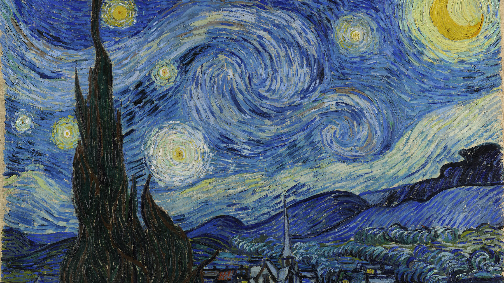
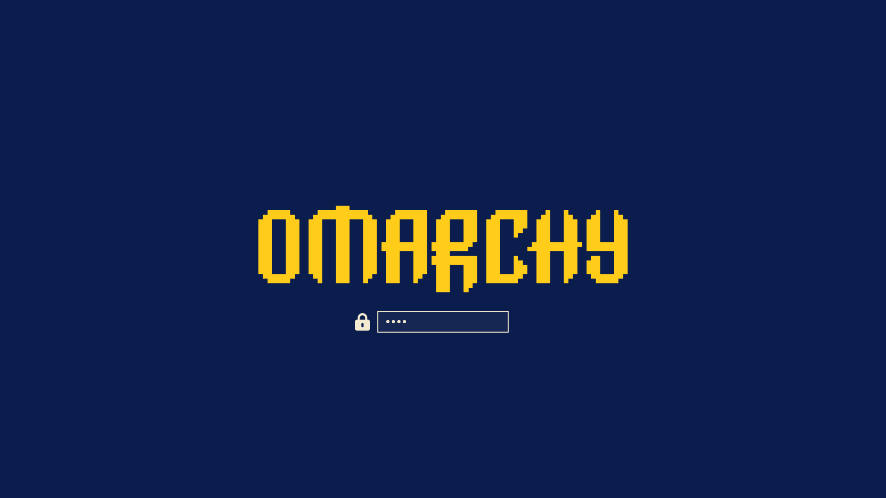

# Van Gogh — an Omarchy theme

A saturated dark theme built from the pigments Vincent van Gogh actually used: ultramarine and cobalt skies, chrome-yellow stars, emerald cypresses, vermilion roofs.



## Install

```bash
omarchy theme install https://github.com/Van-Ausburn/omarchy-van-gogh-theme
omarchy theme set van-gogh
```

Cycle through the paintings with `omarchy theme bg next`.

## Palette

Drawn from *The Starry Night* (1889), with accents from *Sunflowers*, *Irises* and *Café Terrace at Night*.

| Role | Color |
|---|---|
| `accent` | `#ffcc1a` |
| `selection` | `#2b4fa8` |
| `muted` | `#5a6fa8` |
| `background` | `#0b1d4d` |
| `dark_background` | `#08163b` |
| `darker_background` | `#050f2a` |
| `lighter_background` | `#1a3378` |
| `foreground` | `#f3ead0` |
| `dark_foreground` | `#8ea0cf` |
| `light_foreground` | `#e0d6b4` |
| `bright_foreground` | `#fff8e1` |
| `red` | `#ff5a36` |
| `yellow` | `#ffcc1a` |
| `orange` | `#ff9a1f` |
| `green` | `#3fbf6f` |
| `cyan` | `#2fd3d0` |
| `blue` | `#4a8cff` |
| `magenta` | `#c77dff` |
| `brown` | `#c0762a` |
| `bright_red` | `#ff8a6b` |
| `bright_yellow` | `#ffe066` |
| `bright_green` | `#6fe39a` |
| `bright_cyan` | `#6ff0ec` |
| `bright_blue` | `#80b0ff` |
| `bright_magenta` | `#dda8ff` |

## Boot & login screen

The theme ships an `unlock.png` logo in its accent color. To use it for the Plymouth boot screen and SDDM login:

```bash
omarchy plymouth set by theme van-gogh
```



## Wallpapers

All paintings are in the **public domain** and were sourced from Wikimedia Commons:

- [The Starry Night](https://commons.wikimedia.org/wiki/File:Van_Gogh_-_Starry_Night_-_Google_Art_Project.jpg) — Vincent van Gogh, 1889
- [Starry Night Over the Rhône](https://commons.wikimedia.org/wiki/File:Starry_Night_Over_the_Rhone.jpg) — Vincent van Gogh, 1888
- [Irises](https://commons.wikimedia.org/wiki/File:Irises-Vincent_van_Gogh.jpg) — Vincent van Gogh, 1889
- [Almond Blossom](https://commons.wikimedia.org/wiki/File:Vincent_van_Gogh_-_Almond_blossom_-_Google_Art_Project.jpg) — Vincent van Gogh, 1890
- [Wheatfield with Crows](https://commons.wikimedia.org/wiki/File:Vincent_van_Gogh_-_Wheatfield_with_crows_-_Google_Art_Project.jpg) — Vincent van Gogh, 1890

## License

Theme files (palette, icon choice, previews) are MIT licensed — see [LICENSE](LICENSE).
The paintings are public domain.

The boot-screen logo (`unlock.png`) is a recolored copy of the [Omarchy](https://github.com/basecamp/omarchy) wordmark, Copyright (c) David Heinemeier Hansson, used under the MIT License — see [LICENSE-omarchy](LICENSE-omarchy).
